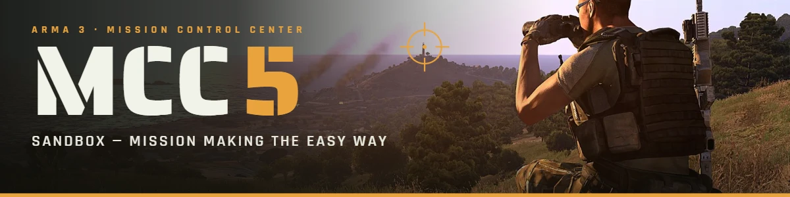

# MCC Sandbox 5 for Arma 3 (v5.1.0)

**Wiki:** https://mcc5-wiki.pages.dev/ · **Steam Workshop:** https://steamcommunity.com/sharedfiles/filedetails/?id=3840123393

The full MCC 5 overhaul: a new Eden and Zeus interface, a rewritten GAIA AI commander, an in-editor Mission Wizard, ACE3/RHS/CUP support and optional limited logistics.

> **Status:** this build has not been tested in game yet. Please report problems with your RPT log (`%LOCALAPPDATA%\Arma 3\*.rpt`) and a screenshot.

## Install
1. Download **ARMA3-MCC5.zip** below. Use the release file, not GitHub's "Code > Download ZIP" button (that is the source code).
2. Unzip it and move the **`@mcc_sandbox_a3`** folder into your Arma 3 folder (e.g. `...\steamapps\common\Arma 3\`).
3. In the Arma 3 Launcher go to **Mods > Local mod** and pick `@mcc_sandbox_a3`.
4. Tick **MCC Sandbox 5** and **CBA_A3** (required). Untick any older MCC version.
- Dedicated server: `-mod=@CBA_A3;@mcc_sandbox_a3` (same for headless clients). The PBO is not signed.
- Optional mods, detected automatically: ACE3, RHS, CUP, LAMBS Danger.fsm, LAMBS Suppression, HBQ Advanced Driving AI.

## Where things are
- **Eden editor:** the **MCC 5** menu in the top menu bar
  - **MCC 5 Mission Settings...**: every MCC setting in one window (each defaults to "Use addon setting")
  - **Mission Wizard... / Generate Mission**: set the options, then the whole mission is built in the editor so you can see and edit it before playing (Ctrl+Z undoes it)
  - **Place MCC Module / Place Settings Module**: quick placement of MCC modules
- **In game:** MCC users get **Zeus** (Ctrl+Delete or Y). Every MCC tool is in the Zeus **Modules** tab. Right-click an AI soldier for quick GAIA orders.

## New in 5.1.0
- **No more lower graphics.** MCC no longer changes your terrain detail, grass or view distance when it loads. Before, it set a low terrain detail and a 5 km view distance for everyone, even with no MCC modules placed. Both settings now default to "keep your own game setting".
- **Smooth operation screen.** The mission start screen no longer flashes: it uses its own fade, waits for respawn screens and other cameras to finish, and fades its colours in and out.
- **Big clean-up after a full review.** GAIA: no more groups switching between two fights, threat counted right, smoke only after real losses, no vehicles taken from players, groups near a Zeus camera stay awake, GAIA no longer deletes other groups. Mission Wizard: a mission no longer counts a failed objective as a win, reinforcements no longer hang or error, hostages can be freed by players who join late, HVT and garrison placement errors fixed. Loading MCC no longer: restores old gear on respawn, takes two tickets per death, turns stamina back on, turns shotgun slugs into stun rounds, starts ambient fires, takes over Zeus double-click when ZEN is loaded, or replaces the mission's respawn marker.

## New in 5.0.5
- **Works with other Zeus support mods.** GAIA used to clear the waypoints of every AI group, not only its own. Groups placed in Zeus or by other mods (CAS runs, helicopter LZ drops, reinforcements) lost their orders when they got into a fight, or after about 80 minutes. GAIA now only touches its own groups.
- **Every mod's modules in MCC's Zeus.** The Zeus MCC 5 gives you now lists the modules and objects of every loaded mod (support mods, ZEN, and so on), not only the ones the mission already used.
- Fixed an IED error when IED module settings came from the editor as text.

## New in 5.0.4
- **GAIA puts the task first.** Groups given to GAIA with **GAIA: Control Group** now march to their task and nothing pulls them away. On the way they return fire and keep moving, and they only stop to fight when enemies get within 150 m. GAIA no longer sends them off to other fights, clear jobs or transport runs, and their order to go to the task never runs out. If the way gets lost after a fight, or the group gets stuck, the order is given again. Once at the task, GAIA runs the group there as before, and a group pulled more than 400 m away walks back.
- **No more surprise friendly units.** GAIA no longer calls reinforcements for a side that has players on it. New setting **Reinforcements For Player Sides** (off by default) turns it back on.

## New in 5.0.3
- **Zeus right-click menu:** right-click an AI soldier (leader or anyone in the squad) for **GAIA: Control Group**, **GAIA: Attack Area**, **GAIA: Defend Area** and **Player Control Group** (take the group back from GAIA). With ZEN loaded, the same options are in the ZEN menu under MCC 5.
- **The MCC 5 button is gone** from the Zeus screen. Every tool is in the Zeus Modules tab.
- **New operation screen at mission start** (Mission Wizard intro, editor and Zeus): a camera sweeps the area, the operation name types in with place, time, weather, enemy and objectives, then a WEAPONS HOLD countdown turns into WEAPONS FREE. Every AI group (both sides) holds fire and players can't fire until it ends.
- **GAIA uses vehicles:** groups now take a nearby empty truck for trips over 500 m (was 1500 m), including enemy-side and mod trucks, with an AI driver even when a player is in the group. AI that don't fit walk as their own group.
- **GAIA goes back to work after a fight:** groups return to their task or zone about 30 s after contact ends, and task-following groups don't chase fights far off their route.
- **Mission Wizard faction fix:** every enemy unit, vehicle, crew, HVT, target, artillery, CAS plane and reinforcement comes only from the chosen faction. Missing pieces are skipped, never taken from another faction.
- **Mission Wizard max units:** Max AI Units is now a hard limit on units actually placed, crews and reinforcements included.

If your mission or server saved **Find Ride Distance** at 1500, set it to 500 (CBA settings or MCC 5 Mission Settings).

## What's new in 5.0

### New interface
- The old MCC menu is replaced by Zeus and Eden. MCC users get Zeus automatically (limit it with the Access Rights module).
- Zeus modules for every old menu feature: Mission Wizard, Artillery, Convoy, Air Drop, CAS Console, Reinforcements, Paradrop, Delete Brush, Jukebox, Hostage, Briefing, Broadcast, Save/Load, Start Location, Mission Start, Arsenal.
- **GAIA: Control Group**: drop it on any AI group (e.g. your BLUFOR squad with you as a member): GAIA takes over, uses vehicles, works through the side's tasks and then patrols its area.
- Eden modules: Mission Wizard, Convoy, Fire Mission, Music/Sound; group attribute for GAIA control; object attribute for Zeus editable.

### Mission Wizard in Eden
- All the old options: up to 8 objectives of all 12 types, factions from a list, difficulty, players, mission size, unit cap, CQB, stealth, vehicles, armor, IEDs, suicide bombers, armed civilians, roadblocks, animals, reinforcements, artillery, weather, intro, markers.
- Generates zones with GAIA, objectives with tasks and win/fail conditions, enemy patrols, garrisons, vehicles, roadblocks, IEDs, civilians, briefing and weather as editor objects in an "MCC Mission Wizard" layer.

### GAIA AI
- Rewritten for performance: one scheduler, cached data, no zone limit, far groups frozen with dynamic simulation.
- Vehicles: infantry borrow empty vehicles for long trips, the whole group (leader included) gets out at the objective, gets back in after a fight, and stuck vehicles recover. Fixed AI driving to the middle of the map.
- AI call artillery, CAS and reinforcements; attacks are coordinated (attack, flank, covering fire, reserve).
- Groups are balanced across all headless clients.
- Works alongside LAMBS Danger, LAMBS Suppression and HBQ Advanced Driving AI.

### Missions, mods and logistics
- Mission Wizard up to 8 objectives, Small to Huge mission size, unit cap; campaigns with up to 3 areas at once.
- ACE3, RHS and CUP detected automatically; their units and vehicles are used by default.
- Optional limited logistics (Off / Fuel only / Full): supply trucks and crates run out and refill at bases.

### Security and fixes
- Network calls rebuilt: no code is sent over the network, full remoteExec whitelist, Normal/Strict network security.
- Many old bugs fixed, including: broken Add Valor Zeus module, Set Resources swapping ammo and repair, East crates ignored, settings registered twice, Mission Wizard hanging, settings modules not applying.
- New MCC 5 artwork (logo and loading screen).

Full details: `MCC_changelog.txt` (R34, R35).

**License:** GPL-3.0, like the original MCC Sandbox. See `LICENSE.md` (also inside the zip). Credit: MCC Sandbox by Shay_gman & Spirit. Discord: https://discord.gg/bxwX5EkMEf
